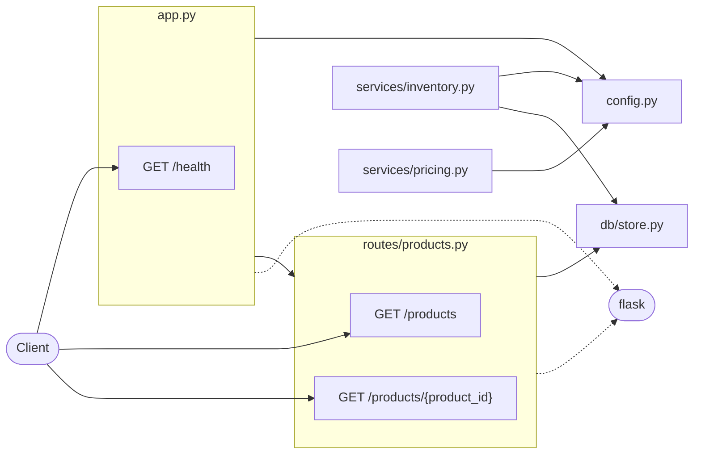
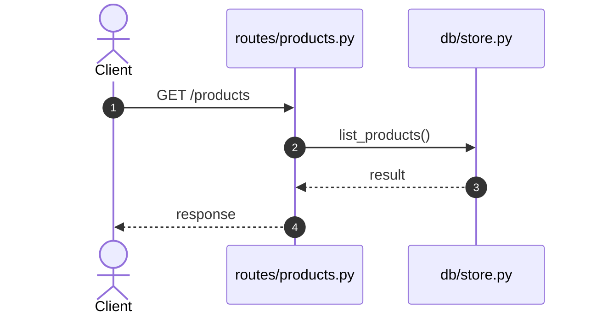
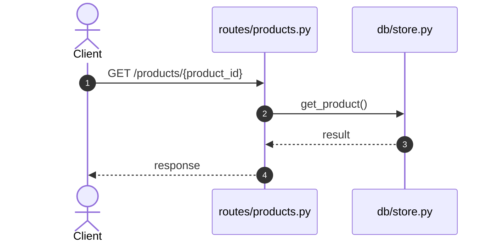

# shop-api — Documentation

> Maintained by **doc-agent**. Content inside `AUTO:*` blocks is regenerated from the code on every push; `NARRATIVE:*` blocks are written by an AI agent. Add your own text anywhere outside these blocks and it will be preserved.

## Overview

<!-- NARRATIVE:overview -->
_Pending: the documentation agent will write this section._
<!-- /NARRATIVE:overview -->

## At a Glance

<!-- AUTO:glance -->
- **Files:** 18
- **Python modules:** 6 (12 top-level functions)
- **HTTP endpoints:** 3
- **Test files:** 2
- **Third-party libraries imported:** `flask`
- **Environment variables:** 4
<!-- /AUTO:glance -->

## Architecture

<!-- AUTO:architecture -->

<!-- /AUTO:architecture -->

<!-- NARRATIVE:architecture_notes -->
_Pending: the documentation agent will write this section._
<!-- /NARRATIVE:architecture_notes -->

## Request Flows

<!-- AUTO:flows -->
#### `GET /products`

Handler: `list_products` in `routes/products.py`



#### `GET /products/{product_id}`

Handler: `get_product` in `routes/products.py`


<!-- /AUTO:flows -->

## Project Structure

<!-- AUTO:structure -->
```text
shop-api/
├── .github/
│   └── workflows/
│       └── docs.yml  # CI: auto-update documentation
├── db/
│   ├── __init__.py
│   └── store.py  # In-memory data store for products and orders (swap for a real DB later).
├── routes/
│   ├── __init__.py
│   ├── orders.py
│   └── products.py  # HTTP endpoints for the product catalogue.
├── services/
│   ├── __init__.py
│   ├── inventory.py  # Stock checks on top of the data store.
│   └── pricing.py  # Pricing rules: discounts and tax.
├── tests/
│   ├── __init__.py
│   ├── test_api.py
│   └── test_pricing.py
├── .gitignore  # Git ignore rules
├── README.md  # Project readme
├── app.py  # Application factory: builds the Flask app and registers blueprints.
├── config.py  # Central configuration, read from environment variables.
├── requirements-docs.txt  # Doc-agent dependencies
└── requirements.txt  # Python dependencies
```
<!-- /AUTO:structure -->

## API Reference

<!-- AUTO:api -->
| Method | Path | Handler | Location | Description |
|---|---|---|---|---|
| `GET` | `/health` | `health` | `app.py:15` | Liveness probe. |
| `GET` | `/products` | `list_products` | `routes/products.py:10` | List all products. |
| `GET` | `/products/{product_id}` | `get_product` | `routes/products.py:16` | Get one product by id. |
<!-- /AUTO:api -->

## Modules

<!-- AUTO:modules -->
### `app.py`

Application factory: builds the Flask app and registers blueprints.

| Signature | Kind | Description |
|---|---|---|
| `create_app() -> Flask` | function | Create and configure the Flask application. |

### `config.py`

Central configuration, read from environment variables.


### `db/store.py`

In-memory data store for products and orders (swap for a real DB later).

| Signature | Kind | Description |
|---|---|---|
| `list_products() -> list` | function | Return all products. |
| `get_product(product_id: int) -> Optional[dict]` | function | Return one product or None. |
| `reduce_stock(product_id: int, qty: int) -> None` | function | Decrease stock after a successful order. |
| `save_order(order: dict) -> dict` | function | Persist an order and assign it an id. |
| `get_order(order_id: int) -> Optional[dict]` | function | Return one order or None. |

### `routes/products.py`

HTTP endpoints for the product catalogue.

| Signature | Kind | Description |
|---|---|---|
| `list_products()` | function | List all products. |
| `get_product(product_id)` | function | Get one product by id. |

### `services/inventory.py`

Stock checks on top of the data store.

| Signature | Kind | Description |
|---|---|---|
| `check_stock(product_id: int, qty: int) -> bool` | function | True if enough stock is available. |
| `is_low_stock(product_id: int) -> bool` | function | True if stock is at or below LOW_STOCK_THRESHOLD. |

### `services/pricing.py`

Pricing rules: discounts and tax.

| Signature | Kind | Description |
|---|---|---|
| `apply_discount(price: float, pct: float) -> float` | function | Apply a percentage discount (0-100) to a price. |
| `add_tax(amount: float) -> float` | function | Add TAX_RATE tax to an amount. |
<!-- /AUTO:modules -->

## Dependencies

<!-- AUTO:dependencies -->
| Package | Version | Source |
|---|---|---|
| `flask` | `>=3.0` | requirements.txt |
<!-- /AUTO:dependencies -->

## Configuration

<!-- AUTO:env -->
| Variable | Default | Used in |
|---|---|---|
| `DEBUG` | `'false'` | `config.py` |
| `LOW_STOCK_THRESHOLD` | `'5'` | `config.py` |
| `PORT` | `'5000'` | `config.py` |
| `TAX_RATE` | `'0.18'` | `config.py` |
<!-- /AUTO:env -->

## Setup & Usage

<!-- NARRATIVE:setup_usage -->
_Pending: the documentation agent will write this section._
<!-- /NARRATIVE:setup_usage -->

## Tests

<!-- AUTO:tests -->
| File | # | Test functions |
|---|---|---|
| `tests/test_api.py` | 2 | `test_health`, `test_create_order` |
| `tests/test_pricing.py` | 3 | `test_discount`, `test_discount_invalid`, `test_tax` |
<!-- /AUTO:tests -->
